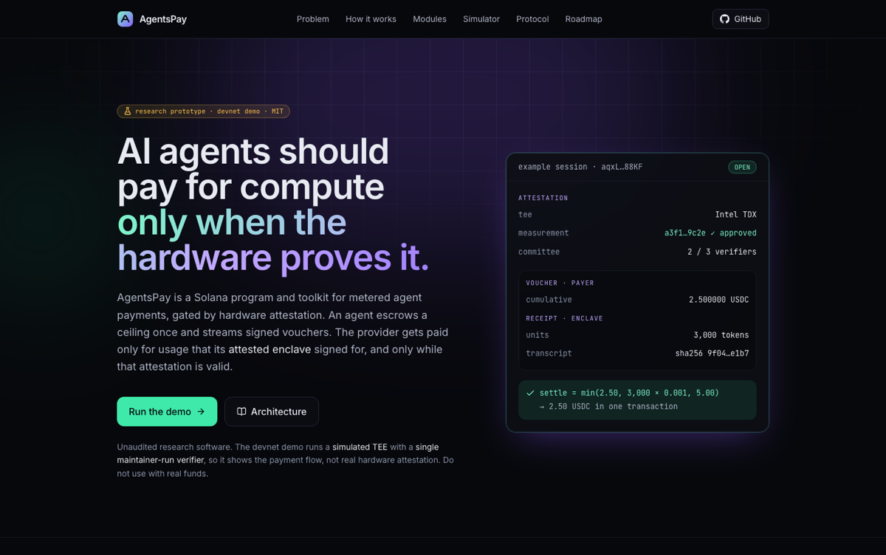
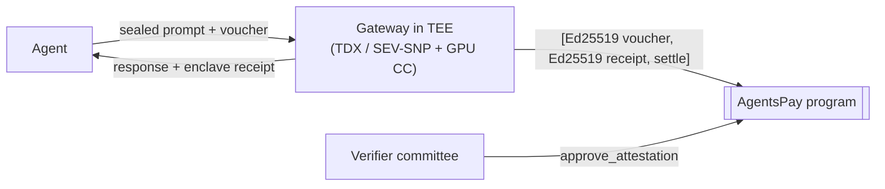

<div align="center">


# AgentsPay

**Attestation-gated, metered payments for AI agents on Solana.**<br/>
Pay for compute only when the hardware proves it.

[](https://github.com/maitreya-ai/AgentsPay-Sol/actions/workflows/ci.yml)
[](LICENSE)


[](https://explorer.solana.com/address/EZsX7kN4Zb555Aaov2v9MBUC543JVmL5P6cQGAytUkdT?cluster=devnet)

[Overview](docs/project-overview.md) · [Architecture](docs/architecture.md) · [Live on devnet](#live-on-devnet) · [Quickstart](#quickstart) · [SDK](#use-the-sdk) · [Website](#website)



</div>

---

## Why

Agents already pay per call on Solana: x402 runs mostly on Solana, and the Foundation's **Payment Channels** let an agent escrow a ceiling once and settle once. But settlement is **blind to delivery**. A voucher proves the payer authorised an amount. Nothing proves that the inference ran, that it ran the advertised model on attested hardware, or that the operator didn't inflate the token count.

The Solana Foundation spelled out what's missing: *tokenized GPU-hours, TEE-attested private inference, and contracts that pay a provider only when a valid hardware attestation exists.* AgentsPay builds that primitive.

## What it does

Every settlement needs **two signatures**:

| | Signed by | Proves |
| --- | --- | --- |
| **Voucher** | the agent's ephemeral session key | "I authorise up to *X* in total" |
| **Usage receipt** | a key generated *inside* the provider's TEE | "this enclave served *N* units" |

The program pays `min(voucher, N × price, deposit)`, **and only while the provider's hardware attestation is valid.** Revoke the attestation and payments stop; the payer can exit immediately.



### Five on-chain modules

| Module | What you get |
| --- | --- |
| 🛡️ **Attestation registry** | Enclave keys bound to governance-approved workload measurements, approved by an M-of-N verifier committee. One verifier can revoke; revoking a measurement kills every dependent attestation. |
| ⚡ **Attested sessions** | Payment channels settled with voucher + enclave receipt. The operator can't over-bill and the payer can't under-pay; the payer exits instantly if attestation lapses. |
| 👛 **Agent vaults** | Owner-funded budgets with per-session caps, rolling limits, TEE and paid-reputation gates, expiry and a kill switch. No per-request owner signature. |
| 🪙 **Compute credits** | Tokenized GPU capacity: SPL credits backed 1:1 by escrowed payment, sold only while attested, refundable at par if the provider defaults. |
| ⭐ **Paid feedback** | Ratings only from sessions that settled real value, emitted as `PaidFeedback` for the 8004 Agent Registry. |

Plus an off-chain toolkit in TypeScript on **Bun**: SDK, OpenAI-compatible provider gateway with sealed prompts, attestation verifier, agent demo and website.

## Live on devnet

| | Address |
| --- | --- |
| **Program** | [`EZsX7kN4Zb555Aaov2v9MBUC543JVmL5P6cQGAytUkdT`](https://explorer.solana.com/address/EZsX7kN4Zb555Aaov2v9MBUC543JVmL5P6cQGAytUkdT?cluster=devnet) |
| Config | [`BkoKLmzuh7RsZxd4oDnrTMg32e2bM2pTVHMRXg2bW5fL`](https://explorer.solana.com/address/BkoKLmzuh7RsZxd4oDnrTMg32e2bM2pTVHMRXg2bW5fL?cluster=devnet) |
| Test USDC mint | [`5oM8u9DrsYYYbbjQyhYLW8uxb3kv8Ls6yQ7PqrzVCJac`](https://explorer.solana.com/address/5oM8u9DrsYYYbbjQyhYLW8uxb3kv8Ls6yQ7PqrzVCJac?cluster=devnet) |
| Demo provider | [`D7nZAi76dafwPSrMoBX6ysdegPAj6A33eNuab5cjpcrd`](https://explorer.solana.com/address/D7nZAi76dafwPSrMoBX6ysdegPAj6A33eNuab5cjpcrd?cluster=devnet) |

Real transactions from the end-to-end demo on devnet:

- 🛡️ [Verifier approves a provider's TEE attestation](https://explorer.solana.com/tx/5JWMqeBxTTqY9THZ2gyaAoD6sbxZpedaoK11PJPs8S6PsRh5H2wiD4Ew89Z4LiE8nWdQVi3Zg6dJmfwuMakJN3nT?cluster=devnet)
- ⚡ [One transaction settles 3 paid inference calls (voucher + enclave receipt) and refunds the rest](https://explorer.solana.com/tx/46WqbkgqmwT9GoYeA8xZgCCdZLQpxSoAiixZDNuogqzrBDp9ZsX1nezfQQF5sX3sdnx7wKqS66mr3fjqyfqMLpCr?cluster=devnet)
- ⭐ [Payment-backed rating from the agent](https://explorer.solana.com/tx/kF8Edi4fDEDaFPV34nryv3ruoUSU7epsdYwcVFikwkPjYPXgVQ85g8mSRqiCHe6djDFZt4gpsE5hozJf43ENGHp?cluster=devnet)

All addresses are in [`deployments/devnet.json`](deployments/devnet.json). The devnet deployment uses the **simulated TEE** and a one-member verifier committee run by the maintainer, so treat it as a demo, not a security boundary.

Run the agent yourself against devnet: `bash scripts/demo-devnet.sh` (after `bun run bootstrap` with `RPC_URL=https://api.devnet.solana.com`; see [Deploy to devnet](#deploy-to-devnet)).

## Quickstart

**Prerequisites:** Rust 1.97, Solana CLI 4.x, Anchor 1.2.2, Bun 1.4.

```bash
git clone https://github.com/maitreya-ai/AgentsPay-Sol.git && cd AgentsPay-Sol
bun install

anchor build && bash scripts/sync-idl.sh   # build program + sync IDL into the SDK
cargo test -p agentspay                    # 31 program tests (unit + LiteSVM)
bun run test                               # SDK + web tests

bun run demo                               # end-to-end on localnet ↓
```

`bun run demo` starts `solana-test-validator` with the program, bootstraps a test USDC mint and config, starts a verifier and a gateway (simulated TEE), then runs an agent that:

```text
▶ Discovering attested providers on-chain
  TEE Simulated, enclave key 4o4JV7kB…, attestation valid until …
▶ Checking the endpoint's challenge against the on-chain attestation
  keys match ✔  price 20 base units / token
▶ Owner funds an AgentVault; agent opens a session under its policy
  session aqxLsEkb… escrowed 2.000000 USDC
▶ Sending sealed prompts, paying per token with cumulative vouchers
    36 tokens, cumulative 36 → owes 0.000720 USDC (receipt ✔ transcript ✔)
    34 tokens, cumulative 70 → owes 0.001400 USDC (receipt ✔ transcript ✔)
    26 tokens, cumulative 96 → owes 0.001920 USDC (receipt ✔ transcript ✔)
▶ Cooperative close: provider settles once, escrow remainder returns to the vault
  settled 0.001920 USDC in one tx · vault refunded 1.998080 USDC
▶ Rating the provider with payment-backed feedback
  provider stats: settlements=1 units=96 avgRating=95
✔ demo complete
```

Prefer separate terminals? Run `bun run localnet`, `bun run bootstrap`, `bun run verifier`, `bun run gateway` and `bun run demo:agent`.

### Deploy to devnet

```bash
bash scripts/deploy-devnet.sh   # deploys with your Solana CLI wallet as upgrade authority, then bootstraps
```

`initialize` only accepts the program's **upgrade authority**, so nobody can front-run the deployer. Public addresses are written to `deployments/devnet.json`. To run the gateway, verifier and agent against devnet, point them at it with `RPC_URL=https://api.devnet.solana.com`.

## Use the SDK

```ts
import { Connection, Keypair } from "@solana/web3.js";
import { AgentsPayClient, encodeVoucher, HEADERS, serializeSigned, signMessage } from "@agentspay/sdk";

const client = AgentsPayClient.fromKeypair(new Connection(RPC_URL), wallet);

// 1. Only providers whose hardware attestation is valid right now
const [provider] = await client.listProviders({ onlyAttested: true, minRating: 80 });

// 2. Escrow a ceiling once; vouchers are signed by a throwaway key
const sessionKey = Keypair.generate();
const { session } = await client.openSession({
  provider: provider.address,
  mint: USDC,
  deposit: 2_000_000n,        // 2 USDC
  pricePerUnit: 20n,          // per token
  authorizedSigner: sessionKey.publicKey,
});

// 3. Pay per request with a cumulative voucher
const voucher = signMessage(encodeVoucher({ session, cumulativeAmount: 50_000n, expiresAt: 0n }), sessionKey);
const res = await fetch(`${provider.account.endpoint}/v1/chat/completions`, {
  method: "POST",
  headers: {
    "content-type": "application/json",
    [HEADERS.session]: session.toBase58(),
    [HEADERS.voucher]: serializeSigned(voucher),
  },
  body: JSON.stringify({ messages: [{ role: "user", content: "Hello from an agent" }] }),
});
// res.headers.get(HEADERS.receipt) → enclave-signed usage receipt
```

The SDK also covers vaults (`createVault`, `openSessionFromVault`), credits (`createOffering`, `buyCredits`, `refundCredits`), sealed prompts (`seal`, `openReply`) and evidence helpers (`reportData`, `parseTdxQuote`). See [`examples/agent-demo`](examples/agent-demo/src/index.ts) for the full flow.

## Repository layout

```
programs/agentspay/     Anchor program: 23 instructions, LiteSVM tests
packages/sdk/           @agentspay/sdk: client, PDAs, codecs, sealing, evidence
apps/gateway/           provider gateway (Bun + Hono), simulated & Intel TDX enclaves
apps/verifier/          attestation verifier (committee member)
apps/web/               website: Vite + React + TypeScript + Tailwind
examples/agent-demo/    end-to-end agent
scripts/                localnet · bootstrap · demo · IDL sync
docs/                   project overview · architecture
```

## Running a provider

The gateway is configured through environment variables:

| Variable | Default | Meaning |
| --- | --- | --- |
| `TEE` | `simulated` | `simulated` (dev) or `tdx` (configfs-tsm quotes inside a TDX guest) |
| `MODEL_BACKEND` | `echo` | `echo` or `openai` (any OpenAI-compatible server: vLLM, SGLang, Ollama…) |
| `UPSTREAM_URL` / `UPSTREAM_MODEL` | `http://127.0.0.1:11434` / `llama3.1:8b` | inference engine reachable from inside the CVM |
| `PRICE_PER_UNIT` | `20` | token base units per metered token |
| `ACCEPT_MINT` | from bootstrap | stablecoin mint to accept |
| `PUBLIC_URL` / `PORT` | `http://127.0.0.1:8787` / `8787` | advertised endpoint |
| `SETTLE_EVERY_MS` | `15000` | settlement cadence |

Verifiers take `VERIFIER_KEYPAIR`, `ALLOW_SIMULATED` and `DCAP_VERIFY_CMD` (an external Intel DCAP verifier that receives the quote on stdin).

## Website

```bash
bun run web          # dev server
bun run web:build    # static build in apps/web/dist
```

The site explains the problem and protocol and includes a **live settlement simulator** that mirrors the on-chain rule. Revoke the attestation and watch the payment stop.

## Status & roadmap

> ⚠️ **Unaudited research software.** Localnet only. Do not use with real funds.

- [x] Program: attestation registry, attested sessions, vaults, credits, paid feedback
- [x] SDK, gateway (simulated + TDX), verifier (simulated + TDX + DCAP hook), agent demo, website
- [ ] SEV-SNP, NVIDIA CC (NRAS) and AWS Nitro verifiers
- [ ] x402 `upto` / MPP `session` wire compatibility
- [ ] 8004 bridge: `PaidFeedback` → `giveFeedback`
- [ ] ZK attestation: SP1 / RISC Zero DCAP proof → Groth16 on `alt_bn128`
- [ ] Payment Channels interop: AgentsPay as an attested PDA payee
- [x] Devnet deployment
- [ ] Security audit

## Contributing

Issues and PRs are welcome, especially verifiers for new TEE families, x402/MPP adapters and the 8004 bridge. Before opening a PR, run `cargo test -p agentspay`, `bun run typecheck` and `bun run test`.

## License

[MIT](LICENSE)

<sub>Built on ideas from the Solana Foundation's Payment Channels, the 8004 Agent Registry and the Foundation's AI roadmap. AgentsPay is an independent open-source project and is not affiliated with the Solana Foundation.</sub>
