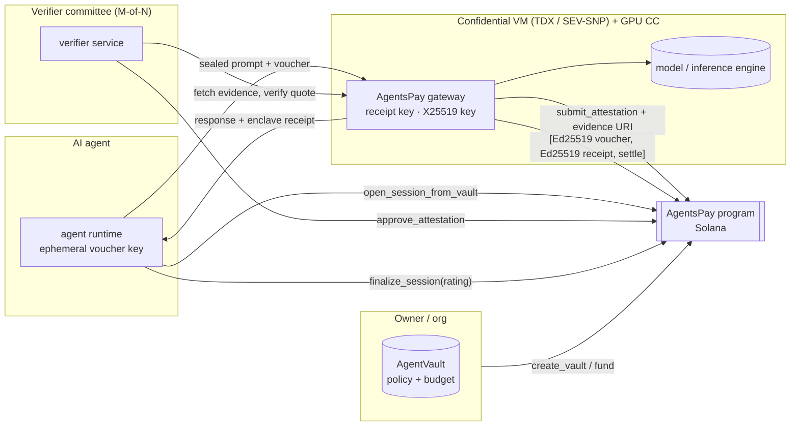
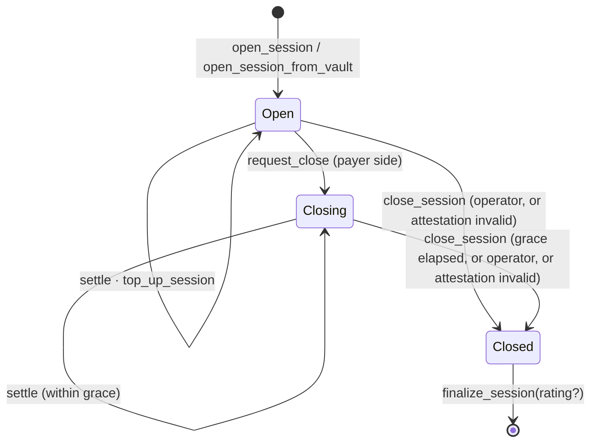
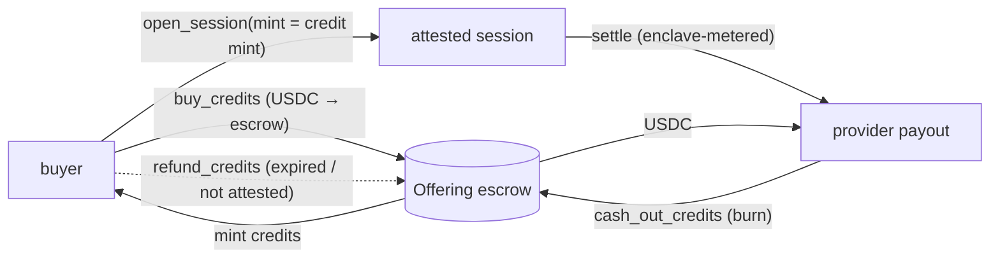

# Architecture

This document describes how AgentsPay works: components, on-chain accounts, the settlement rule, the attestation pipeline, the HTTP protocol, and the security model. For the motivation, see [project-overview.md](./project-overview.md).

- [1. System at a glance](#1-system-at-a-glance)
- [2. Repository layout](#2-repository-layout)
- [3. On-chain program](#3-on-chain-program)
- [4. Signed messages](#4-signed-messages)
- [5. Attestation pipeline](#5-attestation-pipeline)
- [6. Session lifecycle](#6-session-lifecycle)
- [7. HTTP protocol](#7-http-protocol)
- [8. Agent vaults](#8-agent-vaults)
- [9. Compute credits](#9-compute-credits)
- [10. Paid feedback and 8004](#10-paid-feedback-and-8004)
- [11. Security model](#11-security-model)
- [12. Design decisions](#12-design-decisions)
- [13. Known limitations](#13-known-limitations)

---

## 1. System at a glance



There are three trust anchors:

1. **Hardware**: the TEE vendor's root of trust (Intel, AMD, NVIDIA) signs a quote over the launch measurement and `REPORTDATA`.
2. **Governance**: the admin approves which *workload measurements* (reproducible builds of gateway + model) may be paid for.
3. **Verifier committee**: M-of-N keys attest that they verified the vendor quote. Today this is a committee; the design leaves room for a ZK proof instead.

## 2. Repository layout

```
programs/agentspay/          Anchor 1.2.2 program (Rust)
  src/instructions/          admin · provider · attestation · session · vault · credits
  src/messages.rs            voucher / receipt codecs + settle rule
  src/ed25519.rs             canonical Ed25519 precompile introspection
  tests/                     LiteSVM integration tests (session, vault, credits)
packages/sdk/                @agentspay/sdk: PDAs, codecs, sealing, evidence, typed client
apps/gateway/                reference provider gateway (Bun + Hono)
apps/verifier/               attestation verifier service
apps/web/                    project website (Vite + React + Tailwind)
examples/agent-demo/         end-to-end agent
scripts/                     localnet, bootstrap, demo, IDL sync
```

## 3. On-chain program

Program ID (localnet/devnet placeholder): `EZsX7kN4Zb555Aaov2v9MBUC543JVmL5P6cQGAytUkdT`

### 3.1 Accounts

| Account | Seeds | Purpose |
| --- | --- | --- |
| `Config` | `["config"]` | admin, treasury, verifier set (≤ 8), threshold, fee (≤ 10%), max attestation TTL, `allow_simulated_tee`, `paused` |
| `Measurement` | `["measurement", tee_type, value[0..32], value[32..48]]` | governance-approved 48-byte workload measurement + model hash + label |
| `Provider` | `["provider", operator]` | payout wallet, optional 8004 agent asset, endpoint, active attestation, stats |
| `Attestation` | `["attestation", provider, enclave_key]` | enclave Ed25519 key, X25519 key, TEE type, measurement, evidence hash/URI, approvals, status, expiry |
| `Session` | `["session", payer_or_vault, provider, salt]` | escrow ceiling, price, voucher signer, enclave key snapshot, settled watermark, units, transcript, status |
| `AgentVault` | `["vault", owner, agent, mint]` | owner policy and counters |
| `Offering` | `["offering", provider, id]` | credit mint, payment mint, price per credit, cap, expiry |
| credit mint | `["credit_mint", offering]` | 0-decimal SPL mint; authority = offering PDA |

Token escrows are canonical associated token accounts owned by the session, vault or offering PDA. SPL Token and Token-2022 are both accepted through `token_interface`.

### 3.2 Instructions

| Module | Instruction | Signer | Notes |
| --- | --- | --- | --- |
| Governance | `initialize` | admin | creates `Config` |
| | `update_config` | admin | rotate admin, treasury, committee, fee, TTL, simulated flag, pause |
| | `approve_measurement` | admin | allowlist a workload |
| | `revoke_measurement` | admin **or any verifier** | invalidates every dependent attestation instantly |
| Providers | `register_provider` / `update_provider` | operator | |
| Attestation | `submit_attestation` | operator | enclave key ≠ operator / payout key |
| | `approve_attestation` | verifier | Valid once approvals from *current* verifiers ≥ threshold |
| | `revoke_attestation` | admin, any verifier, or operator | clears `provider.active_attestation` |
| Sessions | `open_session` | payer | escrows deposit; binds active attestation + enclave key |
| | `top_up_session` | anyone | refunds always go to `session.payer` |
| | `settle` | anyone (crank) | `[Ed25519(voucher), Ed25519(receipt), settle]` |
| | `request_close` | payer side | starts grace period |
| | `close_session` | operator (cooperative), anyone after grace, anyone if attestation invalid | refunds escrow, closes escrow ATA |
| | `finalize_session` | payer side | optional 0–100 rating; closes account |
| Vaults | `create_vault` / `update_vault` / `withdraw_vault` | owner | |
| | `open_session_from_vault` | agent | enforces policy |
| Credits | `create_offering` | operator | |
| | `buy_credits` | buyer | only while provider attested |
| | `cash_out_credits` | provider payout or treasury | burn → payment token at par |
| | `refund_credits` | any holder | only after expiry or loss of attestation |

### 3.3 The settlement rule

```
require  session.status == Open  ||  (Closing && now < close_requested_at + grace)
require  attestation.is_valid(measurement, now)
require  ix[-2] = Ed25519(voucher) signed by session.authorized_signer
require  ix[-1] = Ed25519(receipt) signed by session.enclave_key
require  voucher.session == receipt.session == session
require  voucher fresh;  receipt.cumulative_units >= session.units_settled

target = min(voucher.cumulative_amount,
             receipt.cumulative_units × session.price_per_unit,
             session.deposit)
require  target > session.settled
pay      (target − settled) − fee  → provider.payout
pay      fee                       → treasury
settled = target
```

`Attestation::is_valid` = status `Valid` ∧ `now < expires_at` ∧ the measurement account (PDA-checked) is still `approved` and matches.

Both messages are **cumulative**, so the newest pair supersedes older ones, replays settle nothing, and one settlement can cover any number of requests.

## 4. Signed messages

Fixed-length, little-endian, domain-separated by a 4-byte magic.

| Voucher (52 B) | | |
| --- | --- | --- |
| `0..4` | magic | `"APV1"` |
| `4..36` | session | pubkey |
| `36..44` | cumulative_amount | u64 |
| `44..52` | expires_at | i64, 0 = none |

| Usage receipt (84 B) | | |
| --- | --- | --- |
| `0..4` | magic | `"APR1"` |
| `4..36` | session | pubkey |
| `36..44` | cumulative_units | u64 |
| `44..76` | transcript_hash | `sha256(prev ‖ sha256(request) ‖ sha256(response))` |
| `76..84` | issued_at | i64 (enclave clock, informational) |

**Precompile introspection.** The program accepts exactly one Ed25519 precompile layout: one signature, pubkey at 16, signature at 48, message at 112, with every `*_instruction_index = u16::MAX` ("this instruction"). That rules out the classic bug where offsets point into a different instruction's data. The magic prefixes also differ from transaction messages (`0x80`, small counts), off-chain messages (`0xff`) and the Foundation's payment-channel voucher (`[0x56, 0x01]`).

## 5. Attestation pipeline

```mermaid
sequenceDiagram
  participant G as Gateway (in CVM)
  participant HW as TEE hardware
  participant P as AgentsPay program
  participant V as Verifier(s)
  G->>G: generate Ed25519 receipt key + X25519 key (memory only)
  G->>HW: quote(REPORTDATA = sha256("agentspay:attest:v1" ‖ provider ‖ enclave_key ‖ enc_key))
  HW-->>G: vendor-signed quote
  G->>G: evidence bundle {quote, keys, measurement}; serve at /evidence/<sha256>
  G->>P: submit_attestation(keys, tee, measurement, evidence_hash, uri, ttl)
  V->>P: poll pending attestations
  V->>G: GET evidence_uri
  V->>V: hash == evidence_hash · fields == on-chain · REPORTDATA binds keys · quote chain + TCB · measurement
  V->>P: approve_attestation  (×M)
  P->>P: status = Valid, expires_at = now + min(ttl, max_ttl), provider.active_attestation = this
```

**Workload measurement (48 bytes):**

| TEE | Measurement |
| --- | --- |
| Intel TDX | `SHA-384(MRTD ‖ RTMR0 ‖ RTMR1 ‖ RTMR2 ‖ RTMR3)`: pins firmware, kernel, cmdline and the app layer |
| AMD SEV-SNP | report `MEASUREMENT` (roadmap) |
| NVIDIA CC | CPU CVM measurement + GPU evidence via NRAS, nonce = report data (roadmap) |
| Simulated | `SHA-384("agentspay-gateway:<ver>|backend=<b>|model=<m>")`, signed by a public dev "vendor" key |

**Verifier implementation status.** Simulated: full. TDX: parsing, measurement derivation and key binding are implemented; signature-chain and TCB verification are delegated to an external DCAP tool via `DCAP_VERIFY_CMD`, and the verifier refuses if none is configured. SEV-SNP, NVIDIA and Nitro are refused with an explicit reason.

**Lifecycle.** Approvals need M signatures; revocation needs one. Verifiers periodically re-check valid attestations and revoke ones whose evidence stops verifying. Revoking a *measurement* (e.g. a CVE in the gateway build) invalidates every attestation that carries it, in one transaction.

**Roadmap: ZK verification.** Verify the DCAP chain inside SP1 or RISC Zero and submit a Groth16 proof checked with Solana's `alt_bn128` syscalls. The `approve_attestation` path becomes "proof verified" rather than "M signatures", and sessions do not change.

## 6. Session lifecycle



- **Cooperative close.** The gateway submits `[Ed25519(voucher), Ed25519(receipt), settle, close_session]` in one transaction: final payment plus refund.
- **Payer exit.** `request_close` → the provider may still settle during grace → anyone may `close_session` afterwards.
- **Attestation lapse.** If the attestation is revoked, expired, or its measurement revoked, `settle` fails and anyone can `close_session` immediately.

## 7. HTTP protocol

| Step | Request | Response |
| --- | --- | --- |
| Discover | `GET /.well-known/agentspay` | `Challenge` JSON: program, provider PDA, attestation, enclave + encryption keys, TEE, measurement, accepted mints + price, min deposit, grace, max units per request |
| Unpaid call | `POST /v1/chat/completions` | `402` + `Challenge` + `WWW-Authenticate: Payment method="solana", intent="agentspay-session-v1", request="…"` |
| Paid call | headers `x-agentspay-session`, `x-agentspay-voucher`; body JSON or `application/agentspay-sealed+json` | OpenAI-shaped completion (sealed back if sealed), `x-agentspay-receipt`, `x-agentspay-units`, `x-agentspay-cost` |
| Close | `POST /agentspay/close {session}` | `{settled, signature}` |
| Evidence | `GET /evidence/<sha256>` | evidence bundle |

**Client obligations.** Before opening a session, check that the challenge's `enclaveKey` and `encryptionKey` equal the on-chain attestation. This proves the endpoint you're talking to is the attested enclave. Then verify every receipt's signature and recompute the transcript hash.

**Server obligations** (mirroring the Foundation's ADR-002):

- Admit a session only if it targets this provider and this enclave key, uses an accepted mint, and meets price, deposit and grace minimums.
- Accept vouchers in a single linearizable per-session transition, persisting the full signed voucher *before* serving. The voucher must cover `(units_so_far + max_units_this_request) × price`.
- Key all metering by session address.
- Settle periodically and on close.

**Sealed prompts.** The agent seals the body with X25519 + XSalsa20-Poly1305 (`nacl.box`) to the attested encryption key, using an ephemeral key. The enclave seals the reply back to that ephemeral key, so the agent can check the reply came from the attested key.

## 8. Agent vaults

Policy fields: `max_per_session`, `period_limit` / `period_seconds` (rolling), `min_provider_rating` (0–100 average of *paid* ratings), `allowed_tee_mask` (bit per `TeeType`), `expires_at`, `frozen`.

- `open_session_from_vault` is signed by the **agent**, never the owner. The session's `payer` is the vault PDA, so refunds return to the vault.
- An unspent deposit is credited back to `period_spent` only if the session was opened in the current period.
- The owner can freeze, change policy or withdraw at any time; the agent cannot.

## 9. Compute credits

Invariant: `offering_escrow_balance == credit_supply × price_per_credit`.



Credits are ordinary SPL tokens, so they can trade on any DEX. That is the "tokenized GPU-hours" market: a buyer holds a fully backed claim on attested capacity, and if the provider stops being attested, the claim refunds at par.

## 10. Paid feedback and 8004

`finalize_session(Some(rating))` requires `settled > 0` and a payer-side signer, and accepts one rating per session (the account is closed). It updates `provider.stats` and emits:

```rust
PaidFeedback { session, provider, agent_asset, payer, mint, settled, units, rating, transcript_hash }
```

`provider.agent_asset` links to the provider's 8004 / Metaplex Core identity. A relayer (roadmap) forwards `PaidFeedback` to 8004 `giveFeedback`, with the session address as an unforgeable proof of payment. That restores the validation signal the 8004 Solana port archived.

## 11. Security model

| Actor | Can't | Because |
| --- | --- | --- |
| Provider operator (host) | bill more than the enclave metered | receipts need the enclave key, which lives only in CVM memory and is bound to the quote |
| | get paid without a valid attestation | `settle` checks attestation + measurement in the same instruction |
| | redirect funds | payout = `provider.payout`; fee = `config.treasury`; escrow authority is the session PDA |
| Payer / agent | consume without paying | the gateway requires a covering voucher, persisted before inference |
| | settle against another session or replay | messages bind the session address; cumulative watermarks only move forward |
| Rogue agent (vault) | exceed the owner's policy | caps, period limits, TEE/rating gates and freeze are enforced on-chain |
| Single verifier | approve alone | approval needs M; a single verifier *can* revoke (fail-safe) |
| Anyone | lock funds forever | grace-period close is permissionless; an invalid attestation allows immediate exit |

**Checks worth noting:** canonical Ed25519 layout only; magic plus length domain separation; the enclave key may not equal the operator or payout key; the escrow balance is re-read after deposit (rejects transfer-fee-style shortfalls); PDA-checked measurement accounts; Anchor 1.x duplicate-mutable-account checks; `overflow-checks = true`.

## 12. Design decisions

- **Why a native session program instead of CPI into Payment Channels v1?** Its `settle` verifies only the payer voucher. Requiring a second, hardware-rooted signature atomically with the transfer has to happen in the program that moves the funds. We kept its proven ideas: cumulative Ed25519 vouchers, precompile introspection, grace-period force close, prefund tolerance. On the roadmap is an interop path where an AgentsPay PDA is the channel's **payee** and releases to the provider only with a valid attestation (the Foundation program explicitly supports PDA payees with CPI signer seeds).
- **Why a committee first?** On-chain DCAP needs P-256 chains, collateral and CRLs; SEV-SNP and NVIDIA need P-384, which has no precompile. A committee ships now. Its trust is bounded by measurement allowlists, single-signer revocation and TTLs, and the approval path can later be swapped for ZK proofs.
- **Why cumulative receipts with a transcript hash?** One signature can cover arbitrarily many requests, so settlement cost stays O(1) per session. The transcript makes metering auditable by the payer.
- **Why the escrow refund goes to `session.payer` (possibly a vault PDA)?** Agents never custody funds, and owners keep the money even if the agent key leaks.

## 13. Known limitations

- **Unaudited.** Localnet only. Do not use with real funds.
- `initialize` is first-caller-wins. Deploy and initialize atomically; gating on the upgrade authority is planned.
- The verifier fetches arbitrary `evidence_uri`s. Run it isolated (SSRF), with timeouts and size limits (implemented).
- The gateway's metering ledger is a local JSON file, single process. Production needs a durable store.
- Settlement requires the attestation to be valid *at settle time*, so providers must settle before expiry and re-attest on rotation.
- TEEs are not magic: side channels, vendor key compromise and TCB recalls are in scope for revocation, not prevention.
- Freeze authorities on stablecoin mints can wedge escrows (same trust model as the Foundation channels). Gateways should allow-list mints.
